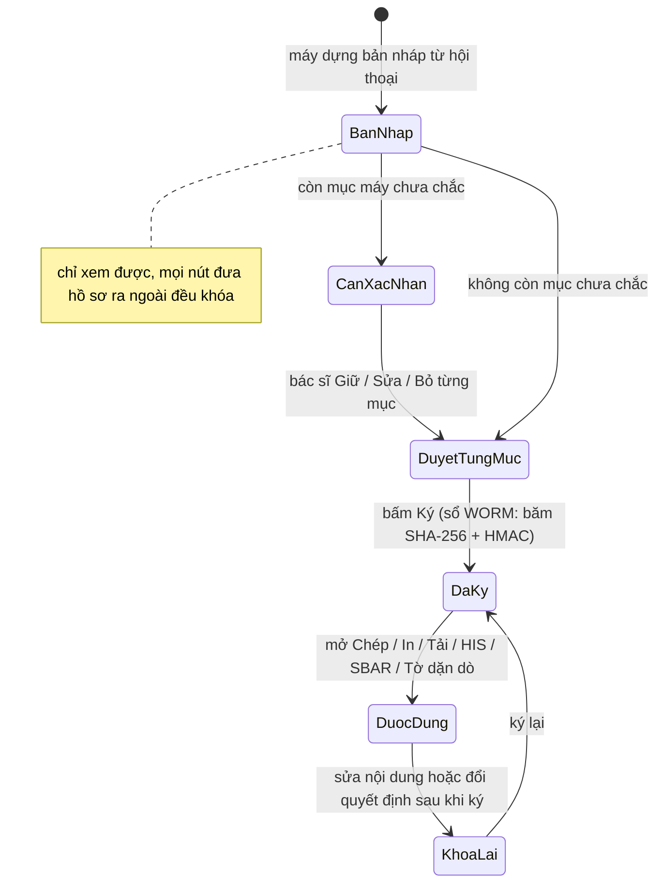
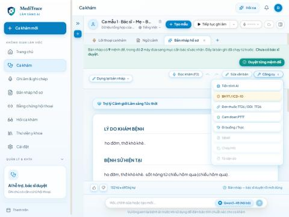
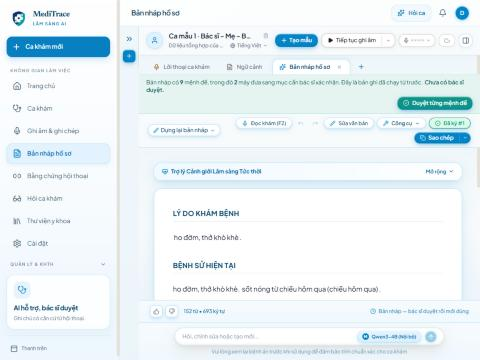
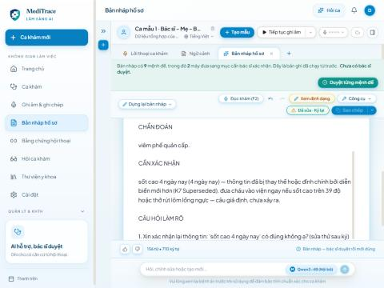

# Quy trình bác sĩ phê duyệt trước khi dùng hồ sơ

MediTrace chỉ soạn **bản nháp**. Hồ sơ chỉ được đưa ra khỏi phần mềm (chép, in, tải tệp, chép sang HIS, phiếu SBAR, tờ dặn dò) sau khi bác sĩ đã duyệt hết các mục chưa chắc và ký. Sửa gì sau khi ký thì hồ sơ khóa lại và phải ký lại.

## Từng bước, mỗi bước có bằng chứng

| Bước | Điều xảy ra | Chặn ở đâu | Test chứng minh |
|---|---|---|---|
| 1. Bản nháp mới | Chỉ xem được. Mọi lối đưa hồ sơ ra ngoài đều khóa, rê chuột thấy lý do *"Bác sĩ chưa ký duyệt — hồ sơ chỉ được xem, chưa được chép, in hay xuất."* | `web/src/lib/choPhepDungHoSo.ts`, `web/src/components/NoteEditorView.tsx` | `web/src/lib/choPhepDungHoSo.test.ts` |
| 2. Còn mục *Cần bác sĩ xác nhận* | Nút Ký báo *"Cần xác nhận (n)"*, không ký được | `kiemTraDieuKienKyDuyet` trong `web/src/lib/compileEffectiveNote.ts` | `web/src/lib/compileEffectiveNote.test.ts`, `web/src/lib/quyTrinhPheDuyet.test.ts` |
| 3. Chọn *Sửa* mà để trống | Vẫn chưa đủ điều kiện | như trên | `quyTrinhPheDuyet.test.ts` bước 2 |
| 4. Mệnh đề không có lượt hội thoại làm căn cứ | Phải sửa hoặc bỏ mới ký được | như trên | `compileEffectiveNote.test.ts` |
| 5. Ký | Máy chủ băm nội dung đã duyệt và các quyết định Giữ/Sửa/Bỏ, ghi vào sổ chỉ được thêm (WORM), ký HMAC | `web/may-chu/worm.ts`, `web/may-chu/routes/sign-off.ts` | `web/may-chu/worm.test.ts`, `web/may-chu/routes/sign-off.test.ts` |
| 6. Được dùng hồ sơ | Các nút mở | `choPhepDungHoSo` | `quyTrinhPheDuyet.test.ts` bước 4 |
| 7. Sửa sau khi ký | Băm đổi → hồ sơ khóa lại, lý do *"Hồ sơ đã sửa sau lần ký — cần ký lại…"*; đổi quyết định duyệt cũng vậy | `isSignOffStale` + `choPhepDungHoSo` | `quyTrinhPheDuyet.test.ts` bước 5–6 |

Các lối bị khóa: *Sao chép*, *In / Lưu PDF* (hai chỗ trong menu), *Tải .txt*, *Tải .md*, *Tải HL7 FHIR & BHYT (.json)*, *SBAR*, *Chép HIS*, *Tờ dặn dò*.

## Ảnh chụp trên giao diện thật (ca mẫu, máy chủ thử với CSDL tạm)

| Chưa ký: các nút khóa | Đã ký #1: các nút mở | Sửa sau khi ký: khóa lại, đòi ký lại |
|---|---|---|
|  |  |  |

## Kiểm sổ ký duyệt

- Trong phần mềm: `GET /api/worm/verify` trả `{ hopLe, soBanGhi }` (hàm `xacMinhChuoi` trong `web/may-chu/worm.ts`). Sửa tay một bản ghi trong CSDL thì chuỗi băm gãy và `hopLe` thành `false`.
- Chạy test: `cd web; npx tsx --test src/lib/quyTrinhPheDuyet.test.ts src/lib/choPhepDungHoSo.test.ts may-chu/worm.test.ts`.

## Giới hạn, nói thẳng

- Không chặn được việc bôi đen chữ trên màn hình rồi Ctrl+C. Phần mềm chỉ khóa các nút đưa hồ sơ ra ngoài.
- Không chặn được phím in của trình duyệt (Ctrl+P). Vì vậy bản in khi chưa ký tự mang dòng **"BẢN NHÁP — CHƯA KÝ DUYỆT"** ở đầu trang.
- Phần mềm chưa đo việc bác sĩ có duyệt bừa hay không. Đó là việc tiếp theo: thử với người dùng, cấy sẵn lỗi nguy hiểm để xem họ bắt được bao nhiêu.
