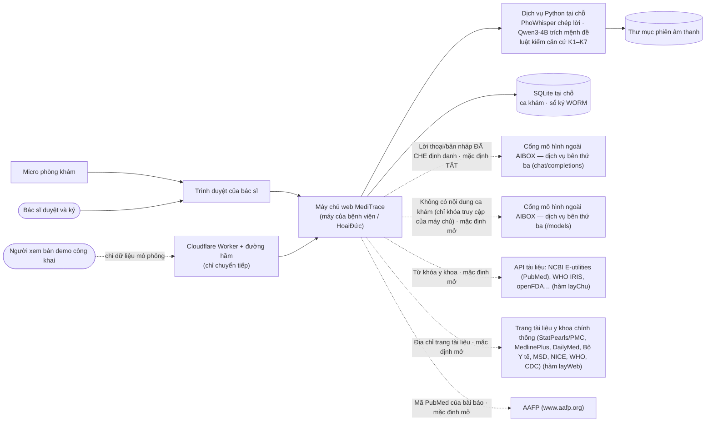

# Sơ đồ dữ liệu — MediTrace Sentinel

Dữ liệu ca khám đi đâu, lưu ở đâu, và lối nào ra khỏi máy. Tệp này **sinh từ mã**: danh sách lối ra mạng
(`web/may-chu/loi-ra-mang.ts`, có test đếm mọi lời gọi mạng của máy chủ) và danh sách nơi lưu
(`web/may-chu/noi-luu-du-lieu.ts`). Mã thêm lối ra mà không khai báo thì test đỏ.

## Luồng chính

Bản demo công khai đi qua Cloudflare: mã Worker chỉ chuyển tiếp, không lưu hay đọc nội dung, nhưng Cloudflare
là nơi giải mã TLS nên vẫn thấy lưu lượng. Vì vậy bản demo **chỉ dùng dữ liệu mô phỏng** (màn đăng nhập có ghi).
Bản cho phòng khám chạy hoàn toàn trong mạng của bệnh viện.

## Lối ra mạng

| Đích | Để làm gì | Dữ liệu đi ra và cách bảo vệ | Mặc định | Mã |
|---|---|---|---|---|
| Dịch vụ MediTrace (Python) trên cùng máy, MEDITRACE_API, mặc định 127.0.0.1:8765 | Chép lời, trích mệnh đề, kiểm căn cứ, dựng bản nháp — chạy tại chỗ | Âm thanh và lời thoại ca khám; không rời máy (địa chỉ nội bộ, kèm khóa nội bộ) | mở | `web/may-chu/routes/dung-chung.ts` |
| Cổng mô hình ngoài AIBOX — dịch vụ bên thứ ba (chat/completions) | Tính năng phụ: sửa bản nháp theo lời nhắc, hỏi đáp về ca, soạn văn bản | Lời thoại/bản nháp ĐÃ CHE định danh; còn định danh thì từ chối gửi (422). Phải qua công tắc quản trị (mặc định tắt) và công tắc của bác sĩ (trình duyệt nhớ) | **tắt** | `web/may-chu/routes/llm-ngoai.ts` |
| Cổng mô hình ngoài AIBOX — dịch vụ bên thứ ba (/models) | Kiểm tình trạng cổng | Không có nội dung ca khám (chỉ khóa truy cập của máy chủ) | mở | `web/may-chu/routes/llm-ngoai.ts` |
| API tài liệu: NCBI E-utilities (PubMed), WHO IRIS, openFDA… (hàm layChu) | Tra tài liệu y khoa | Từ khóa y khoa; ô tìm từ chối từ khóa có tên/mã/số liên lạc (422) | mở | `web/may-chu/tra-cuu/nguon-ngoai.ts` |
| Trang tài liệu y khoa chính thống (StatPearls/PMC, MedlinePlus, DailyMed, Bộ Y tế, MSD, NICE, WHO, CDC) (hàm layWeb) | Đọc nội dung tài liệu để trả lời có nguồn | Địa chỉ trang tài liệu; từ khóa do bước tra cứu đặt từ văn bản đã che | mở | `web/may-chu/tra-cuu/nguon-ngoai.ts` |
| AAFP (www.aafp.org) | Mở bài AAFP theo mã PubMed | Mã PubMed của bài báo; không có dữ liệu ca khám | mở | `web/may-chu/tra-cuu/nguon-ngoai.ts` |

Dịch vụ Python có đúng một lối ra mạng: gọi máy xa của đội khi chạy với `--mo-hinh-xa` (mặc định không bật);
hội thoại được che định danh và kiểm lại trước khi gửi, còn sót thì từ chối (`src/he_thong/dich_vu_http.py`,
test `tests/test_loi_ra_mang_python.py`).

## Nơi lưu dữ liệu

| Nơi | Nội dung | Có định danh | Ai đọc được | Giữ bao lâu | Mã |
|---|---|---|---|---|---|
| Bảng ca_kham (SQLite máy chủ web) | Lời thoại, bản nháp, quyết định duyệt, tên bệnh nhân, ngày khám | có | Chỉ bác sĩ sở hữu ca (mọi truy vấn lọc theo nguoi_dung_id) | Đến khi bác sĩ xóa ca; chưa có hạn tự xóa | `web/db/schema.sql` |
| Bảng ban_sao (bản sao trước khi ghi đè) | Bản sao dữ liệu kho của chính người dùng | có | Chỉ người dùng đó | 30 bản gần nhất cho mỗi kho; chưa có hạn theo ngày | `web/db/schema.sql` |
| Bảng muc_kho (lịch sử tra cứu, mẫu văn bản, hồ sơ bệnh nhân, nhiệm vụ) | Danh sách nhỏ theo từng người dùng | có | Chỉ người dùng đó | Đến khi người dùng xóa | `web/db/schema.sql` |
| Bảng nhat_ky (nhật ký hoạt động) | Hành động, mã phiên, số đếm, địa chỉ IP; không có nội dung ca khám | không | Quản trị | Không giới hạn | `web/may-chu/csdl.ts` |
| Bảng worm_signoff (sổ ký duyệt không sửa được) | Băm SHA-256 nội dung đã ký, HMAC, số mệnh đề giữ/sửa/bỏ, người ký, thời điểm; không có nội dung | không | Quản trị, người ký | Vĩnh viễn (sổ chỉ được thêm) | `web/may-chu/worm.ts` |
| Bảng viec_nen, viec_tro_ly (hàng đợi việc) | Tải trọng và kết quả của việc dựng bản nháp / trợ lý (có lời thoại) | có | Người dùng tạo việc | Việc quá 30 phút bị đánh dấu thất bại; Việc đã kết thúc (xong/thất bại/đã hủy) cũ hơn 30 phút bị xóa định kỳ bởi donViecCu(TUOI_VIEC_TOI_DA_MS) (asr.ts, tro-ly.ts) | `web/may-chu/hang-doi.ts` |
| Thư mục phiên âm thanh (dịch vụ Python) | Tệp ghi âm gốc và bản 16 kHz, lời thoại chép, nhật ký sự kiện | có | Dịch vụ Python tại chỗ | Tệp ghi âm gốc và bản 16 kHz của phiên đã duyệt (gửi sang MediTrace) bị xóa sau 30 ngày kể từ lúc duyệt (MEDITRACE_GIU_AM_THANH_NGAY), và phiên chưa duyệt bị bỏ dở bị xóa sau 7 ngày (MEDITRACE_GIU_AM_THANH_CHUA_DUYET_NGAY), đều ghi sự kiện am_thanh_da_xoa; lời thoại và nhật ký giữ lại. Dọn khi tạo phiên (tối đa 1 lần/ngày), khi api.py khởi động, và khi dich_vu_http.py khởi tạo AudioPipeline | `src/audio/storage.py` |
| Bảng ban_ky_duyet (bản chụp hồ sơ lúc ký) | Số thứ tự WORM, mã tab đã ký, băm nội dung, và bản chụp ca_kham.du_lieu đúng thời điểm bác sĩ ký | có | Chỉ bác sĩ sở hữu ca (đối chiếu lúc xuất) | Vĩnh viễn (trigger SQLite cấm sửa/xóa; gắn với chuỗi WORM) | `web/may-chu/kiem-ky-may-chu.ts` |
| Sổ WORM của dịch vụ Python (data/audit_log_worm.db) | Sự kiện dựng bản nháp: nhánh, nguồn, số mệnh đề; không có lời thoại | không | Quản trị | Vĩnh viễn | `src/he_thong/nhat_ky_ky_duyet_worm.py` |
| Log tiến trình (cửa sổ dòng lệnh máy chủ) | Thông báo lỗi, đã cắt ngắn và che định danh (cheLog / che_log) | đã che | Người vận hành máy chủ | Theo cách người vận hành lưu log | `web/may-chu/che-log.ts` |
| Trình duyệt của bác sĩ (localStorage) | Bản sao danh sách ca khám và các kho (có lời thoại, tên bệnh nhân) để mở nhanh khi tải lại trang; đặc trưng giọng bác sĩ | có | Chỉ máy của bác sĩ | Xóa mọi khóa meditrace_ (ca khám, các kho, mẫu giọng, công tắc gửi ra ngoài) khi đăng xuất, khi hết phiên (401) và khi người khác đăng nhập trên máy đó (web/src/lib/xoaDuLieuTrinhDuyet.ts); chỉ giữ vị trí thanh tác vụ. Đóng trình duyệt mà không đăng xuất thì bản sao còn đến lần đăng nhập sau | `web/src/lib/useKho.ts` |

## Dữ liệu dùng khi phát triển

Chỉ dữ liệu mô phỏng và bộ dữ liệu công khai (xem `docs/nguon-va-giay-phep.md`).
Chưa từng đưa hồ sơ bệnh nhân thật vào công cụ AI nào (tác giả xác nhận 28/11/2026).
Cổng mô hình ngoài AIBOX là dịch vụ bên thứ ba (tác giả xác nhận 28/11/2026).

---
Tệp này sinh từ `web/may-chu/sinh-so-do-du-lieu.ts`; sửa danh sách rồi chạy lại, không sửa tay.
